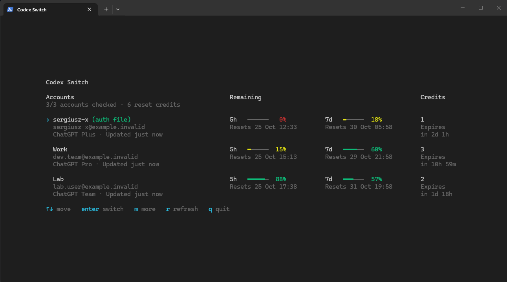
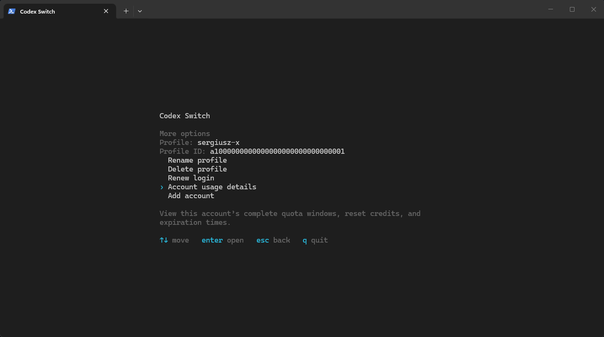

# 🔀 Codex Account Switcher

Switch between saved ChatGPT accounts in Codex CLI.

## 👀 Preview

Real CLI screens with synthetic account data.

<p align="center">
  <strong>Accounts and usage</strong><br>
  
  <br><br>
  <strong>Account actions</strong><br>
  
</p>

## 📦 Install

Linux:

```sh
curl -fsSL https://raw.githubusercontent.com/sergiusz-x/codex-account-switcher/main/install.sh \
  | sh -s -- --repo sergiusz-x/codex-account-switcher
```

Windows PowerShell:

```powershell
$installer = Join-Path $env:TEMP 'codex-switch-install.ps1'
Invoke-WebRequest 'https://github.com/sergiusz-x/codex-account-switcher/releases/latest/download/install.ps1' -OutFile $installer
powershell.exe -NoProfile -ExecutionPolicy Bypass -File $installer
Remove-Item -LiteralPath $installer
```

The Windows installer adds the app to your per-user `PATH`. Open a new terminal after installation.

Requires Codex CLI 0.163.0 with file-based sign-in. Supports Ubuntu Linux
`amd64` and Windows 11 `x64`.

## ⌨️ Use

Sign in to Codex, then run:

```sh
codex_switch
```

Press `s` to save your current account. Use the arrow keys to select an account.

| Key | Action |
| --- | --- |
| `Enter` | Switch to the selected account |
| `m` | Add, rename, renew, restore, or delete an account |
| `r` | Refresh account usage |
| `q` | Quit |

Adding or renewing an account uses Codex's device login in a temporary home. It
does not change your current login. Switching may restart the shared Codex
server and disconnect other Codex clients; the app asks before restarting it.

## 🔐 Accounts and data

Saved accounts contain credentials. Keep `%USERPROFILE%\.codex\switcher` on
Windows or `~/.codex/switcher` on Linux private. Deleting a saved account does
not sign Codex out or change its current login.

Usage is a snapshot and does not verify that a login is still valid. Each quota
window shows its own reset time in your local timezone. Reset credits are listed
separately with their expiry. Set `CODEX_HOME` or use `--codex-home PATH` to use
a different Codex home.

## 🛠️ Development

See [AGENTS.md](AGENTS.md) for build, test, and contribution instructions. The
project uses the [MIT License](LICENSE).
